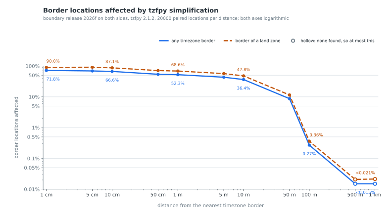

.. _border_accuracy_vs_tzfpy:

=============================
Border Accuracy against tzfpy
=============================

How often this package and the PyPI build of `tzfpy <https://github.com/ringsaturn/tzfpy>`__, which ships simplified polygons, return different zones at a stated distance from a timezone border. :doc:`alternatives` weighs the two packages against each other, and :doc:`benchmark_results_vs_tzfpy` measures their speed and startup.

.. note::

   **What the simplification costs is not small where it matters.**
   Run both packages over a uniform sample of the globe and they never disagree - which is true and
   says nothing, because a uniformly drawn coordinate is hundreds of kilometres from the nearest
   border. So ``scripts/measure_tzfpy_agreement.py`` (``make tzfpy-agreement``) asks the question at
   a *stated distance from a border* instead. Its primary measure draws border locations uniformly
   by length, verifies a probe on each side, and asks whether either answer differs; the secondary
   measure remains a point drawn uniformly from the full two-sided offset locus. Both sweep from
   this package's own ~1.1 cm coordinate grid outwards.

         nine in ten sampled land-zone border locations. Two thirds are affected at a metre and
         almost half at ten metres, falling to no observed disagreement beyond a hundred metres.
   :width: 100%

.. note::

   Boundary release 2026c on both sides, ``tzfpy`` 1.3.3 (the PyPI build, with simplified
   polygons), 20,000 paired border locations and 20,000 individual points per distance, 2026-08-30.

   **Primary: border locations affected.** A location counts once when either of its two verified
   probes has an attributable disagreement. Its ceiling is 100 %, even when simplification moves a
   boundary in only one direction. ``One side`` and ``both sides`` partition the any-border rate;
   the last column is paired locations this package does not attribute to ``tzfpy``.

   .. list-table::
      :header-rows: 1
      :widths: 20 18 20 16 14 12

      * - Distance from a border
        - Any border location
        - Land-zone border location
        - One side
        - Both sides
        - Not attributed
      * - 1 cm
        - 71.8 %
        - 89.6 %
        - 69.0 %
        - 2.79 %
        - 19
      * - 5 cm
        - 69.1 %
        - 90.5 %
        - 69.0 %
        - 0.045 %
        - 0
      * - 10 cm
        - 66.9 %
        - 87.7 %
        - 66.9 %
        - 0.035 %
        - 0
      * - 50 cm
        - 54.4 %
        - 71.4 %
        - 54.4 %
        - 0.025 %
        - 0
      * - 1 m
        - 50.8 %
        - 67.1 %
        - 50.8 %
        - 0.015 %
        - 0
      * - 5 m
        - 43.0 %
        - 56.2 %
        - 43.0 %
        - 0.010 %
        - 0
      * - 10 m
        - 36.0 %
        - 47.5 %
        - 36.0 %
        - 0
        - 0
      * - 50 m
        - 8.63 %
        - 11.6 %
        - 8.63 %
        - 0
        - 0
      * - 100 m
        - 0.20 %
        - 0.27 %
        - 0.20 %
        - 0
        - 0
      * - 500 m
        - 0 observed of 20,000
        - 0 observed
        - 0
        - 0
        - 0
      * - 1 km
        - 0 observed of 20,000
        - 0 observed
        - 0
        - 0
        - 0

   **The near-border effect is now stated on a 0-100 % scale.** At 5 cm the packages differ on at
   least one side of 90.5 % of sampled land-zone border locations; two thirds remain affected at a
   metre and almost half at ten metres. Almost every affected location differs on one side, which
   is the expected signature of a displaced boundary. The 1 cm row is retained for completeness,
   but sits just below this package's stored coordinate step and is not the clean headline: 2.79 %
   differ on both sides and 19 pairs cannot be attributed there; by 5 cm those figures fall to
   0.045 % and zero.

   **The knee is between 10 m and 100 m, and past it the curve stops.** One in nine land-zone
   border locations is still affected at fifty metres and about one in 370 at a hundred. Beyond that,
   across 40,000 paired locations, **not one disagreement is attributable to** ``tzfpy``. That is
   the ~111 m maximum displacement its maintainer states for the simplification, holding as stated.

   Pairing changes the population deliberately. A base site is drawn uniformly by edge length and
   retained only when both normal probes independently verify at the requested nearest-border
   distance. Vertices have zero border length and no unique opposite normal; their circular arcs
   remain represented in the individual-point population below.

   The land-zone curve drops the ocean zones, whose mutual borders are meridians that no simplification
   can move and which therefore dilute the first; a coastline stays in both, since it is stored in the
   land polygon as well as in the ocean polygon around it.

   Two corrections make the numbers attributable rather than merely suggestive. The measurement
   refuses to report unless both packages carry the **same timezone-boundary-builder release**, so a
   difference cannot be a border that moved between datasets; and it asks whether this package's
   answer is among the zones ``tzfpy`` holds over the point rather than whether the two name the same
   one, because the dataset ships genuinely overlapping zones - ``Asia/Urumqi`` inside
   ``Asia/Shanghai`` - that each package resolves by its own rule. Those overlaps are almost every
   difference away from a border and next to none of the ones near it.

   **Secondary: individual-point disagreement.** This is the original probability over the full
   two-sided offset locus. It remains useful for a query chosen without regard to side, but a
   one-direction boundary displacement gives it a natural ceiling near 50 %, so it is no longer the
   headline chart.

   .. list-table::
      :header-rows: 1
      :widths: 25 25 25 25

      * - Distance from a border
        - Any border
        - Border of a land zone
        - Not attributed
      * - 1 cm
        - 37.5 %
        - 47.0 %
        - 15
      * - 5 cm
        - 34.2 %
        - 45.2 %
        - 0
      * - 10 cm
        - 32.9 %
        - 43.4 %
        - 0
      * - 50 cm
        - 26.9 %
        - 35.3 %
        - 0
      * - 1 m
        - 25.2 %
        - 33.3 %
        - 0
      * - 5 m
        - 21.3 %
        - 28.2 %
        - 0
      * - 10 m
        - 17.6 %
        - 23.0 %
        - 0
      * - 50 m
        - 4.3 %
        - 5.7 %
        - 0
      * - 100 m
        - 0.12 %
        - 0.15 %
        - 0
      * - 500 m
        - 0 of 20,000
        - 0 observed
        - 0
      * - 1 km
        - 0 of 20,000
        - 0 observed
        - 0

Reading the last column
~~~~~~~~~~~~~~~~~~~~~~~

**Not every difference belongs to the other package.** Where ``timezone_at`` answers but
:meth:`~timezonefinder.TimezoneFinder.certain_timezone_at` returns ``None``, this package cannot
stand behind the answer without another check. That result proves no *candidate* contains the
quantized point; it does not prove why. A missing shortcut candidate can cause it, but so can a coordinate in a sliver between two neighbouring stored boundaries, where an exhaustive scan finds no containing packaged polygon either. The paired table counts a location here when neither side has
an attributable disagreement and at least one side fails that containment check; the individual
table counts the probes themselves.

The current run leaves 19 paired locations and 15 individual probes in those columns, all at 1 cm -
just below this package's roughly 1.1 cm coordinate grid. For the 15 named individual probes,
exhaustive point-in-polygon checks over all 1,322 packaged polygons find no containing polygon,
while the shortcut already lists the neighbouring zones. They are therefore boundary-grid
ambiguity, not timezonefinder errors and not evidence against ``tzfpy``. The earlier run also
exposed real missing-candidate defects; after the shortcut index was corrected, every one of those
coordinates became an agreement and no unattributed case remains beyond 1 cm.

Every disagreement 100 m or more from a border
~~~~~~~~~~~~~~~~~~~~~~~~~~~~~~~~~~~~~~~~~~~~~~

Listed in full rather than sampled, so the figures above can be checked rather than taken on trust.
The 32 KiB ``docs/tzfpy_agreement.json`` also records every count and named sparse case; it is the
measured source for the SVG and lets the chart be regenerated without repeating the external sweep.
Each coordinate was re-queried against both packages afterwards and its distance to the nearest
border re-measured; the ``border`` column is that measurement, not the distance the point was drawn
at. Boundary release 2026c on both sides, ``tzfpy`` 1.3.3.

**Attributable to** ``tzfpy`` — all 24, and all at 100 m. Beyond that there are none::

     border    latitude    longitude   timezonefinder        tzfpy
      100 m    63.50486    106.56825   Asia/Krasnoyarsk      Asia/Irkutsk
      100 m    10.96478    115.95923   Asia/Manila           Etc/GMT-8
      100 m    11.34167    -63.99829   America/Caracas       Etc/GMT+4
      100 m    32.94443    133.72220   Etc/GMT-9             Asia/Tokyo
      100 m    69.05734   -165.71935   America/Nome          Etc/GMT+11
      100 m     9.82826    112.88880   Asia/Shanghai         Etc/GMT-8
      100 m    16.06440    -82.33148   America/Tegucigalpa   (no zone at all)
      100 m     3.67614    -59.71563   America/Guyana        America/Boa_Vista
      100 m   -10.98399    179.53451   Pacific/Funafuti      Etc/GMT-12
      100 m     7.30759    -60.60160   America/Guyana        America/Caracas
      100 m    10.29734    113.87220   Asia/Ho_Chi_Minh      Etc/GMT-8
      100 m    58.08210     -8.48906   Europe/London         Etc/GMT+1
      100 m   -38.11690    -73.94919   America/Santiago      Etc/GMT+5
      100 m    44.58485     35.08544   Europe/Simferopol     Etc/GMT-2
      100 m   -16.57720   -144.73338   Pacific/Tahiti        Etc/GMT+10
      100 m    39.07428    124.77606   Asia/Pyongyang        Etc/GMT-8
      100 m   -22.98745    151.97899   Australia/Brisbane    Etc/GMT-10
      100 m    11.76343     51.48246   Africa/Mogadishu      Etc/GMT-3
      100 m     8.01813    -58.83736   Etc/GMT+4             America/Guyana
      100 m   -15.56637   -142.00834   Pacific/Tahiti        Etc/GMT+9
      100 m    13.54474     13.13853   Africa/Niamey         Africa/Lagos
      100 m    44.47805    -62.74375   America/Halifax       Etc/GMT+4
      100 m    28.20837   -112.48333   America/Hermosillo    Etc/GMT+7
      100 m     1.73097    -69.62412   America/Manaus        America/Bogota

The ``America/Tegucigalpa`` line is not a wrong zone but *no* zone: ``tzfpy`` returns an empty
result there.
