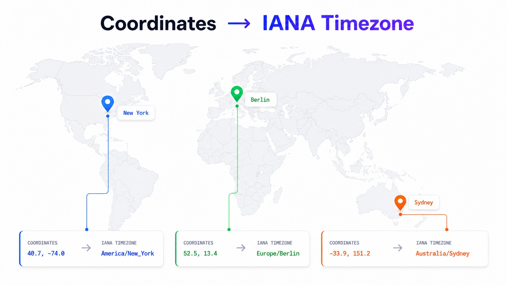

============================
timezonefinder
============================

.. include:: ./badges.rst

This is a Python package providing offline timezone lookups for WGS84 coordinates.
In comparison to other alternatives this package aims at maximum accuracy around timezone borders (no geometry simplifications) while offering fast lookup performance and compatibility with many (Python) runtime environments.
It combines preprocessed polygon data, grid-based spatial shortcuts, and optional acceleration via Numba or a clang-backed point-in-polygon routine.

How it works
------------

A lookup first finds the point's cell in a precomputed grid index.
Most cells lie inside a single timezone, so the index answers directly without touching any geometry.
Only where zones meet does the lookup run an exact point-in-polygon test against the few zones listed for that cell, on coordinates stored to about 1 cm.
:doc:`architecture` walks through the full pipeline, and :doc:`data_format` documents the index and the binary layouts.

**The boundary polygons are never simplified**, so border accuracy is limited only by the source dataset; the grid index is what keeps full-resolution geometry fast.
:doc:`why_no_simplification` explains the trade-off.

The dataset includes ocean zones, so every coordinate on earth gets a timezone - use ``timezone_at_land()`` to tell land from sea.
Where zones overlap, ``timezone_at()`` returns the smaller one and ``timezones_at()`` returns all of them.

References
----------

* `Documentation <https://timezonefinder.readthedocs.io/en/latest/>`__
* `PyPI <https://pypi.python.org/pypi/timezonefinder/>`__
* `conda-forge feedstock <https://github.com/conda-forge/timezonefinder-feedstock>`__
* `download stats <https://pepy.tech/project/timezonefinder>`__
* `online GUI and API <https://timezonefinder.michelfe.it>`__
* `benchmark trend chart <https://jannikmi.github.io/timezonefinder/dev/bench/>`__
* `GUI repository <https://github.com/jannikmi/timezonefinder_gui>`__
* `ruby port <https://github.com/gunyarakun/timezone_finder>`__

.. toctree::
   :maxdepth: 2
   :caption: Using it

   Getting Started <0_getting_started>
   Usage <1_usage>
   Use Cases <2_use_cases>
   API <4_api>

.. toctree::
   :maxdepth: 2
   :caption: Design

   Architecture <architecture>
   Why No Simplification <why_no_simplification>
   Result Stability <result_stability>
   Data Format <data_format>
   Data Report <data_report>
   Alternatives <alternatives>

.. toctree::
   :maxdepth: 2
   :caption: Performance

   Overview <7_performance>
   Benchmarking Methodology <benchmarking_methodology>
   Timezone Finding Benchmarks <benchmark_results_timezonefinding>
   Point-in-Polygon Benchmarks <benchmark_results_polygon>
   Acceleration Paths <benchmark_results_acceleration_paths>
   When Batched Lookups Pay <benchmark_results_batch_break_even>
   Initialization Benchmarks <benchmark_results_initialization>
   Memory Benchmarks <benchmark_results_memory>
   Speed and Startup against tzfpy <benchmark_results_vs_tzfpy>

.. toctree::
   :maxdepth: 2
   :caption: Project

   About <3_about>
   Contributing <5_contributing>
   Changelog <6_changelog>

Indices and tables
==================

* :ref:`genindex`
* :ref:`modindex`
* :ref:`search`
